# ⚙️ Exerion — Industrial & Technological Progression Mod

**Exerion** is an expansive industrial technology mod for Minecraft designed to bridge the gap between primitive survival mechanics and futuristic cybernetic automation. 

Instead of unlocking all high-tech machines instantaneously, **Exerion introduces a structured 10-Era Technological Progression System**, combining physical kinetic torque, explosive steam thermodynamics, and advanced electrical grids.

---

## 📑 Table of Contents
- [🌟 Key Highlights](#-key-highlights)
- [📦 Pre-compiled Downloads (v1.0.4)](#-pre-compiled-downloads-v104)
- [🏛️ The 10 Technological Eras](#️-the-10-technological-eras)
- [⚡ Power & Energy Systems](#-power--energy-systems)
  - [1. Rotational / Kinetic Power](#1-rotational--kinetic-power)
  - [2. Steam Thermodynamics](#2-steam-thermodynamics)
  - [3. Electrical Units (EU) & Power Grid](#3-electrical-units-eu--power-grid)
  - [4. Quantum & Dimensional Storage](#4-quantum--dimensional-storage)
- [🧰 Equipment & Special Tools](#-equipment--special-tools)
- [💻 Installation & Dependencies](#-installation--dependencies)
- [📖 Detailed Documentation Links](#-detailed-documentation-links)
- [📜 License](#-license)

---

## 🌟 Key Highlights

- **10 Evolving Civilizational Eras:** Advance through Stone, Copper, Iron, Mechanical, Steel/Steam, Industrial, Digital, Advanced, Quantum, and Cosmic tiers.
- **Dynamic Era Gating:** Advanced blocks and items are protected from being broken, used, or exploited until players legitimately unlock their required technological tier.
- **Dual Mod Loader Compatibility:** Fully supported on both **Fabric** (via Fabric Loom) and **NeoForge**.
- **Three Interdependent Energy Grids:**
  - 🔄 **Kinetic Torque:** Driven by Water Wheels and Hand Cranks through transmission shafts.
  - 💨 **High-Pressure Steam:** Generated in Coal Boilers (with realistic explosion risks!) to drive high-RPM Steam Turbines.
  - ⚡ **Electrical Units (EU):** Solid fuel generators, geothermal converters, and photovoltaic solar arrays powering high-speed factory lines.
- **Ore Doubling & Metallurgy:** Manual and electric crushers double ore yields with a $25\%$ bonus byproduct chance; gear presses efficiently shape plates and mechanical components.
- **Quantum & Digital Storage:** Wireless cross-dimensional Frequency Ender Chests and unified Digital Storage Terminals.
- **In-Game Guidebook & Scanner:** In-game encyclopedia book and portable Era Scanner.

---

## 📦 Pre-compiled Downloads (v1.0.5)

Both ready-to-play compiled `.jar` binaries are available in the [`releases/`](releases/) folder:

| Loader | Target Version | Binary File | Direct Link |
|:---|:---:|:---|:---:|
| **Fabric** | Minecraft `1.21.x` / `26.1.2` | `exerion-1.0.5.jar` | [Download Fabric JAR](releases/exerion-1.0.5.jar) |
| **NeoForge** | Minecraft `1.21.x` / `26.1.2` | `exerion-neoforge-1.0.5.jar` | [Download NeoForge JAR (Fixed Registry)](releases/exerion-neoforge-1.0.5.jar) |

---

## 🏛️ The 10 Technological Eras

```mermaid
flowchart LR
    E0["Era 0: Stone<br>Primitive Mining"] --> E1["Era 1: Copper<br>Early Metallurgy"]
    E1 --> E2["Era 2: Iron<br>Crushers & Presses"]
    E2 --> E3["Era 3: Mechanical<br>Kinetic Shafts"]
    E3 --> E4["Era 4: Steel / Steam<br>Boilers & Turbines"]
    E4 --> E5["Era 5: Industrial<br>EU Electrical Grid"]
    E5 --> E6["Era 6: Digital<br>Logic & Compute"]
    E6 --> E7["Era 7: Advanced<br>Solar & Geothermal"]
    E7 --> E8["Era 8: Quantum<br>Ender Frequency"]
    E8 --> E9["Era 9: Cosmic<br>Mining Lasers"]
```

To advance between eras, craft the **Progression Terminal**, insert the required tribute resources for your tier, and click **Advance Era**:

| Era | Required Tribute to Evolve | Major Unlocks |
|:---:|:---|:---|
| **0. Stone** | *Initial Starting Level* | Raw Exerion, Exerion Core |
| **1. Copper** | `64x Raw Copper` + `64x Coal` + `64x Raw Iron` | Copper Gears, Water Wheel |
| **2. Iron** | `64x Copper Gear` + `32x Iron Block` + `16x Redstone` | Iron Gears, Manual Crusher, Gear Press |
| **3. Mechanical** | `64x Iron Gear` + `32x Shaft` + `16x Water Wheel` | Mechanical Shafts, Hand Crank, Wrench, Chutes |
| **4. Steel / Steam** | `64x Steel Ingot` + `64x Steam Crystal` + `16x Coal Boiler` | Coal Boiler, Steam Turbine, Steam Boots, Casings |
| **5. Industrial** | `64x Circuit Board` + `64x Exerion Plate` + `64x Steel Cable` | Electric Generator, BatBox, Electric Crusher, Era Scanner |
| **6. Digital** | `64x Logic Chip` + `64x Exerion Gear` + `32x Electric Gen` | Progression Terminal, Digital Storage Terminal, Logic Helmet |
| **7. Advanced** | `64x Solar Panel` + `64x Logic Chip` | Steel & Exerion Solar Panels, Geothermal Gen, Upgrades |
| **8. Quantum** | `64x Exerion Core` + `1x Plasma Sword` | Frequency Ender Chest & Tank, Electric Mining Drill |
| **9. Cosmic** | `64x Exerion Core` | Mining Laser, Full Exerion Suit, Ultimate Mastery |

👉 *For the full in-depth progression manual, see [docs/ERAS_PROGRESSION.md](docs/ERAS_PROGRESSION.md).*

---

## ⚡ Power & Energy Systems

### 1. Rotational / Kinetic Power
- **Water Wheels** and **Hand Cranks** feed rotational force into connected **Mechanical Shafts**.
- Drives the **Gear Press** (doubles plate and gear crafting efficiency) and the **Manual Crusher** (ore doubling with a $25\%$ bonus byproduct dust chance).

### 2. Steam Thermodynamics
- The **Coal Boiler** boils water into condensed **Steam Crystals**.
- > [!CAUTION] Explosion Hazard
  > Running a heated boiler without water results in an instant catastrophic explosion. Always verify water levels before loading fuel!
- The **Steam Turbine** converts steam crystals into simultaneous mechanical torque and electrical current.

### 3. Electrical Units (EU) & Power Grid
- **Electric Generators** produce $10\text{ EU/t}$ from solid fuels.
- **Solar Panels** (Copper $5\text{ EU/t}$, Steel $10\text{ EU/t}$, Exerion $20\text{ EU/t}$) generate clean daytime energy.
- **BatBox** buffers store up to $40.000\text{ EU}$ with directional input/output routing.
- **Electric Crushers** operate $5\times$ faster than manual crushers and accept **Speed** and **Efficiency Upgrades**.

### 4. Quantum & Dimensional Storage
- **Digital Storage Terminal:** Centralized interface that searches, indexes, and extracts items across all connected inventories.
- **Frequency Ender Chest & Tank:** Instantaneous cross-dimensional item and fluid transport synced to customizable frequency channels.

👉 *For full mechanical and electrical specifications, see [docs/MACHINES_AND_ENERGY.md](docs/MACHINES_AND_ENERGY.md).*

---

## 🧰 Equipment & Special Tools

- 🔧 **Wrench:** Right-click to rotate block faces. **Shift + Right-Click** to dismantle any machine instantly, keeping its inventory and energy charge intact.
- 🔍 **Era Scanner:** Inspects blocks and items in the world to determine their required era tier. Recharges inside an active Steam Turbine.
- 🥾 **Steam Boots:** High pneumatic jump dampeners that **negate 100% of fall damage**.
- 🪖 **Logic Helmet:** Integrated heads-up display providing night vision and tactical entity tracking.
- ⛏️ **Electric Mining Drill:** High-speed continuous subterranean tunneling tool.
- ⚔️ **Plasma Sword:** High-damage thermal blade that burns through hostile armor.

👉 *For the complete tools, armor and upgrade guide, see [docs/ITEMS_AND_EQUIPMENT.md](docs/ITEMS_AND_EQUIPMENT.md).*

---

## 💻 Installation & Dependencies

### Fabric Installation
1. Install **Fabric Loader** ($\ge 0.19.3$) for Minecraft `1.21.x` / `26.1.2`.
2. Download the latest **Fabric API**.
3. Place [`releases/exerion-1.0.5.jar`](releases/exerion-1.0.5.jar) into your `.minecraft/mods/` directory.

### NeoForge Installation
1. Install **NeoForge** ($\ge 21.11.3$) for Minecraft `1.21.x` / `26.1.2`.
2. Place [`releases/exerion-neoforge-1.0.5.jar`](releases/exerion-neoforge-1.0.5.jar) into your `.minecraft/mods/` directory.

---

## 📖 Detailed Documentation Links

- 🗺️ **[Technological Eras & Progression Guide](docs/ERAS_PROGRESSION.md)**
- ⚡ **[Machines, Energy & Power Systems Guide](docs/MACHINES_AND_ENERGY.md)**
- 🛡️ **[Tools, Equipment & Materials Catalog](docs/ITEMS_AND_EQUIPMENT.md)**
- 🇵🇹 **[Manual Completo em Português](docs/GUIA_PT.md)**

---

## 📜 License

This project is licensed under the **MIT License** — see the [LICENSE](LICENSE) file for details.

Developed with ❤️ by **Salvador (@teizinh)**.
