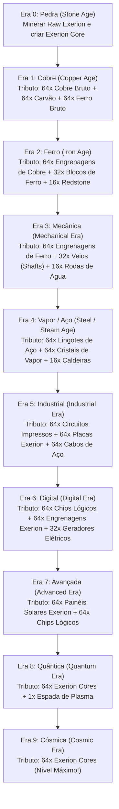

# 🇵🇹 Exerion: Manual Completo em Português

O **Exerion** é um mod industrial de grande escala para Minecraft (disponível para **Fabric** e **NeoForge**), desenvolvido por **Salvador (@teizinh)**. O mod redefine a progressão do jogo através de **10 Eras Tecnológicas**, integrando sistemas mecânicos cinéticos, termodinâmica a vapor e redes elétricas industriais.

---

## 🌟 Visão Geral e Filosofia do Mod

Ao contrário dos mods industriais clássicos onde podes construir um reator nuclear no teu primeiro dia com ferro e carvão, o **Exerion impõe um sistema de civilização estruturado**:
- Começas na **Era da Pedra** onde o minério de Exerion apenas pode ser minerado e transformado manualmente.
- Passas pela **Era do Cobre e do Ferro**, desbloqueando força cinética com rodas de água e prensas de engrenagens.
- Na **Era do Vapor**, geras cristais de vapor em caldeiras para alimentar turbinas gigantes.
- Na **Era Industrial e Digital**, constróis redes elétricas com cabos, acumuladores BatBox e computadores de armazenamento digital.
- Culminas nas **Eras Quântica e Cósmica**, manipulando baús quânticos dimensionais e lasers de escavação massiva.

---

## 🏛️ As 10 Eras Tecnológicas e Como Evoluir

Para avançar na história tecnológica, deves construir o **Terminal de Progressão** (*Progression Terminal*).

> [!WARNING] Bloqueio Dinâmico de Blocos e Ferramentas
> Se tentares partir ou abrir uma máquina de uma era superior à tua, o sistema avisa-te:  
> `[Exerion] You cannot break this block. Requires <Era>!`  
> Usa o **Scanner de Eras** com o botão direito para saberes a que nível pertence qualquer bloco!

---

## ⚙️ Os 3 Pilares de Energia

### 1. Força Cinética (Mecânica Rotacional)
- **Manivela Manual (*Hand Crank*):** Clica com Shift+Direito para rodar manualmente pequenas prensas no início do jogo.
- **Roda de Água (*Water Wheel*):** Coloca água corrente nos lados da roda para gerar rotação passiva perpétua.
- **Prensa de Engrenagens (*Gear Press*):** Pressiona lingotes de ferro, cobre e exerion para produzir chapas e engrenagens com o dobro da eficiência em relação à crafting table.
- **Triturador Manual (*Manual Crusher*):** Duplica os teus minérios (1 minério $\rightarrow$ 2 pós) e oferece $25\%$ de chance de pós raros extras!

### 2. Força a Vapor (Termodinâmica)
- **Caldeira a Carvão (*Coal Boiler*):** Abastece com água (baldes ou bomba mecânica) e carvão para gerar **Cristais de Vapor**.
- > [!CAUTION] Perigo de Explosão Real!
  > Se a caldeira aquecer sem ter água no depósito, **ela explode** destruindo blocos ao redor! Certifica-te sempre de que tem água antes de atear fogo.
- **Turbina a Vapor (*Steam Turbine*):** Consome os cristais de vapor para gerar força mecânica rotacional nos eixos e eletricidade nos cabos.

### 3. Redes Elétricas (Unidades EU)
- **Gerador Elétrico:** Queima carvão ou lenha gerando $10\text{ EU/t}$.
- **Painéis Solares:** Geram energia limpa de dia (Cobre: $5\text{ EU/t}$, Aço: $10\text{ EU/t}$, Exerion: $20\text{ EU/t}$).
- **BatBox:** Bateria para armazenar até $40.000\text{ EU}$.
- **Triturador Elétrico:** Funciona $5\times$ mais rápido que o manual e aceita cartas de aceleração (*Speed Upgrades*).

---

## 🧰 Ferramentas e Equipamentos Especiais

- **Chave Inglesa (*Wrench*):** Clica com o botão direito para rodar máquinas; **Shift + Botão Direito para remover instantaneamente qualquer máquina mantendo todo o seu inventário e energia intactos**!
- **Botas de Vapor (*Steam Boots*):** Anulam completamente qualquer dano de queda e permitem saltos com impulso pneumático.
- **Capacete Lógico (*Logic Helmet*):** Visão noturna permanente e visor tático no HUD.
- **Terminal de Armazenamento Digital:** Acesso a todos os baús ligados através de uma única interface de computador com pesquisa em tempo real.
- **Baú Ender de Frequência:** Transmissão instantânea de itens entre dimensões com código de cores/frequências.
- **Laser de Mineração:** Destrói pedreiras inteiras em segundos a nível cósmico.

---

## 💻 Instalação

1. Certifica-te de que tens o **Minecraft 1.21.x** com **Java 21** ou superior.
2. Descarrega o mod correspondente na pasta `releases/`:
   - Para Fabric: `exerion-1.0.5.jar` (requer Fabric Loader $\ge 0.19.3$ e Fabric API).
   - Para NeoForge: `exerion-neoforge-1.0.5.jar` (requer NeoForge $\ge 21.11.3$).
3. Coloca o ficheiro na pasta `.minecraft/mods/` e inicia o jogo!
